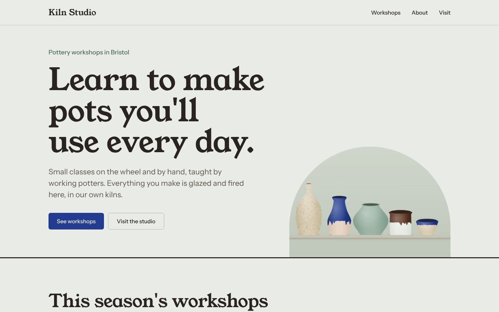
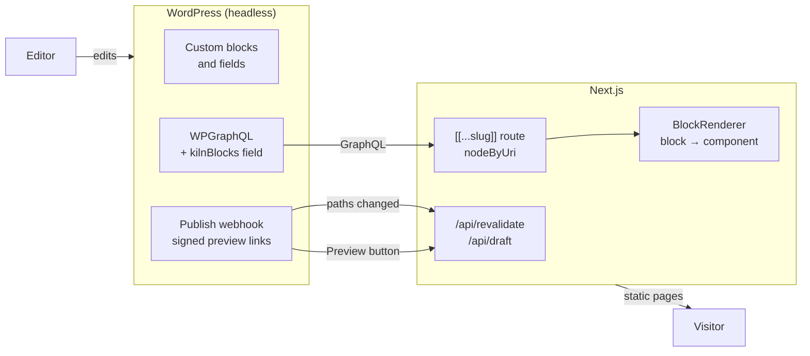

# headless-kiln

A headless WordPress + Next.js starter, shown through a demo site for **Kiln Studio**, a fictional pottery school.

Editors build pages in the WordPress block editor from a set of custom blocks. Next.js renders every page as static HTML, rebuilds only what changed when an editor hits Publish, and opens a live preview of unpublished drafts.

It's the same architecture as a production site I built for a client ([ontrees.it](https://ontrees.it)), rebuilt from scratch in the open with a fictional brand and fresh code.



**Stack:** WordPress · WPGraphQL · Secure Custom Fields (ACF blocks) · Next.js 16 (App Router) · React 19 · TypeScript · Tailwind CSS 4 · Vitest · Playwright · axe

**Lighthouse (mobile, home page):** Performance 97 · Accessibility 100 · Best practices 100 · SEO 100

## How it works



1. **One route for every page.** `app/[[...slug]]/page.tsx` asks WordPress what lives at the requested path (`nodeByUri`). WordPress owns the URL structure, so a new page or a changed slug needs no frontend change.
2. **Blocks map to components.** Each block arrives with its fields already resolved. `components/blocks/registry.ts` maps the block name (`acf/hero`) to a typed React component.
3. **Pages are static until something changes.** When an editor publishes, the plugin tells `/api/revalidate` exactly which paths to rebuild: the page itself, plus the listing pages for a workshop.
4. **Previews show drafts.** WordPress's Preview button opens `/api/draft` with a short-lived signed link. Next.js checks the signature, switches on draft mode, and fetches the latest revision with an application password.

## Decisions I made

**Fields are resolved in WordPress, not in the frontend.**
ACF stores block data in a raw format: attachment IDs instead of images, and repeaters flattened into keys like `items_0_quote`. The plugin's `kilnBlocks` GraphQL field returns each block's fields already formatted: images as `{url, alt, width, height}`, links made root-relative, repeaters as arrays. The frontend never sees ACF's storage details. It also means one plugin (WPGraphQL) is enough, with no block or ACF bridge plugins to keep in step. See `wordpress/plugins/kiln-core/inc/graphql.php`.

**Field groups live in code.**
Every block and field is defined once in `inc/schema.php`. That array registers the field groups, generates the seed content's block markup, and is checked against the demo content in CI (`seed/check-content.php`). Fields can't drift between environments or go missing from a database export.

**The content model lives in a plugin, the theme is a placeholder.**
The theme only redirects visitors to the frontend. Switching themes can't take the content model with it.

**Types reach from the schema to the component.**
`lib/blocks/fields.ts` types each block's fields. The registry is a mapped type over those names, so adding a block type without a component fails to compile. A unit test also checks the registry against the plugin's `block.json` files.

**It runs without WordPress.**
With no `GRAPHQL_ENDPOINT`, the app reads `web/content/kiln-studio.json` through the same interface. That's how CI builds and tests the site, and how the public demo can be hosted for free. The WordPress seed script imports the same file, so both modes show identical content.

**Secrets never travel in URLs.**
Revalidation uses a bearer token, compared in constant time. Preview links carry an HMAC of the post ID and an expiry, never the secret itself. WordPress reads all secrets from `wp-config.php` constants, so they're never in git or the database.

**The contact form is a server action.**
It validates input, rate-limits per address, uses a honeypot instead of a CAPTCHA, and forwards to a WordPress REST endpoint. WordPress saves each enquiry as a private post before emailing it, so nothing is lost if mail fails. Next.js checks server actions come from the site's own origin.

**Accessibility is tested, not assumed.**
Every page runs through axe (WCAG 2.2 AA) in Playwright on desktop and mobile. FAQs use native `<details>` elements. The form moves focus to its result and ties error messages to their fields.

**Images are drawn, not downloaded.**
The pottery illustrations are generated from code (`web/scripts/generate-demo-images.mjs`), so the repo ships no stock photography.

## Run it

### Frontend only (no WordPress)

```bash
cd web
npm install
npm run dev        # http://localhost:3000, on the bundled demo content
```

### With WordPress

You need [Docker](https://www.docker.com/) for the local WordPress.

```bash
cd wordpress
npm install
npm run setup      # starts WordPress, activates the theme, imports the demo content
```

WordPress runs at http://localhost:8888 (admin: `admin` / `password`). The seed prints a preview username and password at the end.

```bash
cd ../web
cp .env.example .env.local   # then paste the preview credentials from the seed output
npm run dev
```

Edit a page in WordPress and publish it: the change shows up on http://localhost:3000. Use **Preview** to see a draft before publishing.

## Tests

```bash
cd web
npm run lint
npm run typecheck
npm test                       # unit tests (Vitest)
npm run build && npm run test:e2e   # end-to-end and accessibility (Playwright + axe)

php ../wordpress/seed/check-content.php   # demo content matches the block schema
```

CI runs all of these on every push (`.github/workflows/ci.yml`).

## Project layout

```
wordpress/
  plugins/kiln-core/        the content model
    inc/schema.php          every block and field, defined once
    inc/fields.php          field groups registered from the schema
    inc/graphql.php         kilnBlocks, workshop fields, studio settings
    inc/frontend.php        revalidation webhook and preview links
    inc/enquiries.php       contact form endpoint
    blocks/*/block.json     one folder per block
  themes/kiln-headless/     placeholder theme
  seed/                     demo content import and schema check
web/
  app/[[...slug]]/          every page and workshop
  app/api/                  revalidate and draft routes
  components/blocks/        one component per block, plus the registry
  lib/content/              GraphQL and fixture sources behind one interface
  content/kiln-studio.json  demo content, shared with the WordPress seed
  tests/                    unit and end-to-end tests
```

## What I'd add next

- Deploy WordPress somewhere small and connect the live demo to it.
- Generate GraphQL types from the schema instead of writing response types by hand.
- Move rate limiting to a shared store (it's in memory, so per server instance).

## Licence

MIT. Kiln Studio, its content and its illustrations are fictional.
